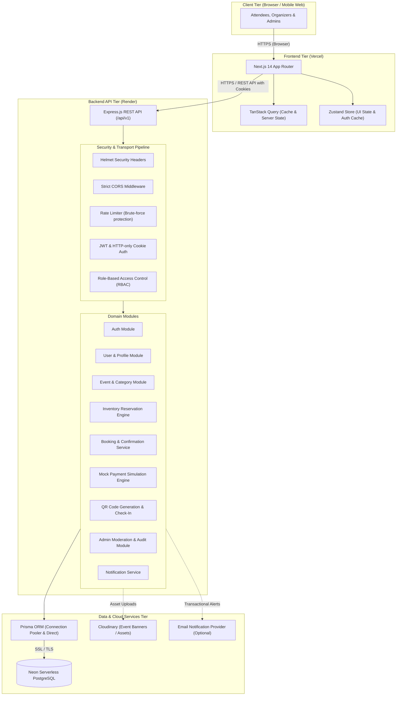
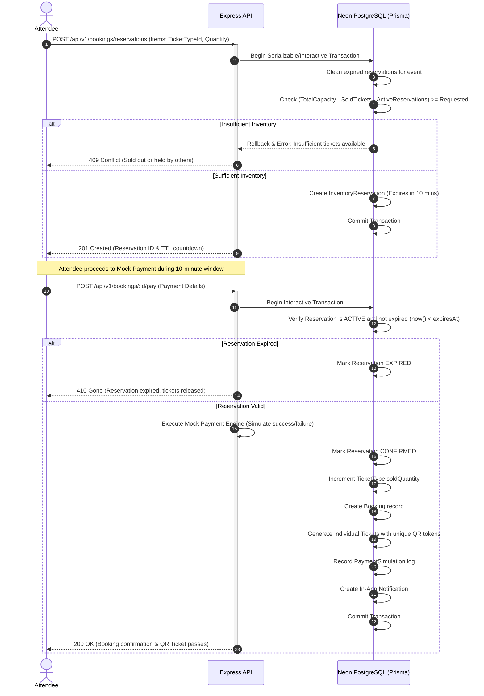

# EVENTRA Application Architecture

## 1. System Overview

EVENTRA is built as a modular full-stack event discovery, booking, and ticketing platform designed for high concurrency, strict role-based access control, and independent deployment of the frontend and backend services.

---

## 2. Tier Breakdown

### 2.1 Client & Frontend Application (`apps/web`)
- **Framework**: Next.js 14 using the App Router.
- **State Management**:
  - **TanStack Query**: Server-state caching, automatic background refetching, and mutation invalidation.
  - **Zustand**: Client-side session and UI state (modals, ticket selection drafts, toast notifications).
- **Forms & Validation**: React Hook Form coupled with Zod schemas sourced from `@eventra/shared`.
- **UI & Styling**: Vanilla CSS and Tailwind CSS following an editorial, premium design aesthetic (navy/charcoal text, warm off-white background, restrained coral accents, and clear subtle borders).
- **Analytics & Visuals**: Recharts for organizer and admin metrics; `qrcode.react` for rendering digital QR passes.

### 2.2 Backend API Service (`apps/api`)
- **Runtime**: Node.js with Express.js written in TypeScript with strict typing.
- **Modular Structure**: Domain-driven feature modules (`auth`, `users`, `events`, `categories`, `tickets`, `bookings`, `payments`, `organizers`, `notifications`, `admin`).
- **Validation**: Incoming requests are validated at the middleware level using Zod.
- **Centralized Error Handling**: Custom `AppError` class mapping business exceptions to standardized HTTP status codes and structured JSON responses.

### 2.3 Database Tier (Neon PostgreSQL & Prisma ORM)
- **Engine**: PostgreSQL hosted on Neon Serverless.
- **Connection Management**:
  - `DATABASE_URL`: Utilizes Neon's connection pooler for high-throughput runtime queries.
  - `DIRECT_URL`: Direct TCP connection for Prisma migrations and schema pushes.
- **Data Integrity**: Foreign keys with cascading rules, database-level unique constraints, transaction-wrapped inventory reservations, and indexes on lookup columns.

---

## 3. Concurrency & Inventory Reservation Architecture

To prevent overselling under high concurrency (flash sales and popular events), EVENTRA uses a two-phase reservation pattern:

---

## 4. Security Architecture

1. **Authentication**: Short-lived JSON Web Tokens (15 minutes) signed with HMAC-SHA256, paired with rotating Refresh Tokens (7 days) stored in `HttpOnly`, `SameSite=Lax`, and `Secure` cookies.
2. **Password Security**: Passwords hashed using `bcryptjs` with salt rounds = 12. Plaintext passwords are never logged or stored.
3. **Role-Based Authorization (RBAC)**: Strict role guards on backend routes verifying token identity against the database, preventing privilege escalation.
4. **Ownership Validation**: Every operation on events, bookings, tickets, and profiles verifies that `req.user.id` owns the target entity or possesses `ADMIN` privileges.
5. **No Client Trust**: Ticket prices, totals, capacities, and validity are calculated exclusively on the server.
6. **QR Code Security**: QR codes store an opaque cryptographically-random UUID token (`ticketToken`). The check-in endpoint validates this token server-side, preventing ticket forgery.
