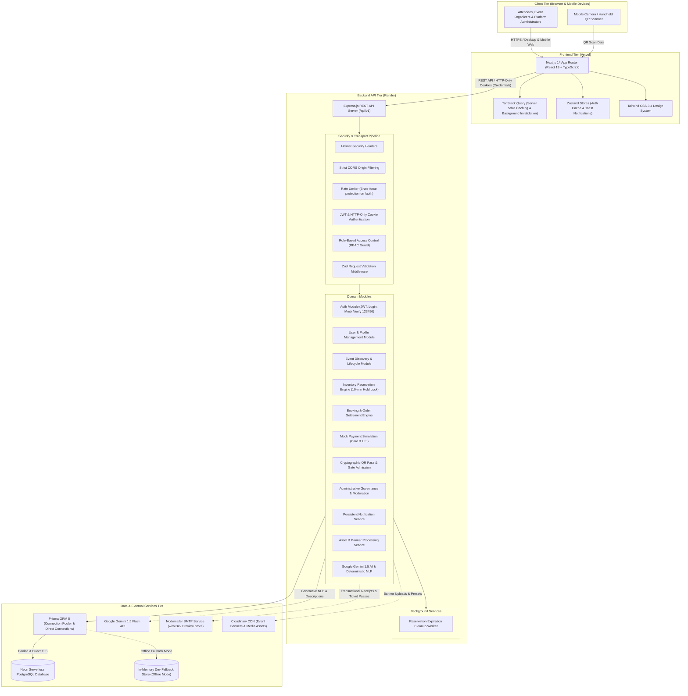
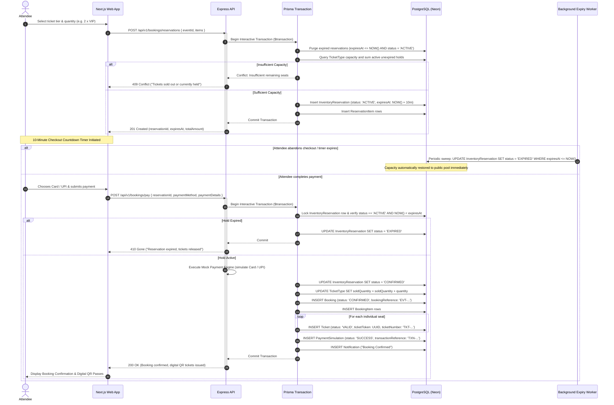

# EVENTRA System Architecture & Technical Specification

## 1. System Overview

**EVENTRA** is an enterprise-grade, full-stack event discovery, booking, and ticket management platform designed for high concurrency, cryptographic gate check-in, and strict role-based access control. The platform follows a decoupled client-server architecture consisting of a Next.js 14 frontend hosted on Vercel, an Express.js TypeScript REST API hosted on Render, and a PostgreSQL database managed via Prisma ORM on Neon Serverless.



---

## 2. Tier Breakdown & Technology Stack

### 2.1 Client & Frontend Application (`apps/web`)
- **Hosting Platform**: Vercel.
- **Production URL**: `https://eventra-lxtc0uqsr-meiyarasanmeiyarasan3-7028s-projects.vercel.app/`
- **Framework**: Next.js 14 utilizing the App Router with hybrid Server/Client component rendering.
- **State Management**:
  - **TanStack Query (v5)**: Manages asynchronous server state, automated background revalidation, query deduplication, and cache invalidation upon booking or event mutation.
  - **Zustand (v4)**: Manages client-side sessions, immediate authentication state, and floating obsidian glassmorphic toast notifications.
- **Forms & Client Validation**: React Hook Form with Zod schema resolvers importing contracts from `@eventra/shared`.
- **Design System & Styling**: Tailwind CSS 3.4 with custom color tokens:
  - Deep obsidian background: `#0B0F19`
  - Elevated surfaces: `#111827`, `#0B151E`
  - High-energy brand accents: Orange (`#FF6A00`) and Coral (`#FF3D8E`)
- **Visuals & Charts**:
  - **Recharts (v2)**: Interactive SVG graphs tracking ticket sales, gross revenue, and gate check-in rates in the organizer studio and admin console.
  - **qrcode.react (v3)**: Client-side rendering of cryptographic digital passes.
  - **Lucide React**: Vector icons.

### 2.2 Backend API Service (`apps/api`)
- **Hosting Platform**: Render (Web Service).
- **Runtime**: Node.js 20 LTS with Express.js 4 in strict TypeScript mode.
- **Architecture**: Domain-driven feature modules organized into controllers, services, and route definitions (`auth`, `users`, `events`, `categories`, `bookings`, `tickets`, `organizers`, `admin`, `notifications`, `upload`, `ai`).
- **Middleware Pipeline**:
  1. `trust proxy`: Configured for reverse proxy deployment behind Vercel/Render edge networks.
  2. `helmet`: Configures secure HTTP headers while keeping Swagger UI operable.
  3. `cors`: Restricts cross-origin requests to configured frontend origins with full cookie credential transmission support.
  4. `cookieParser`: Extracts signed and unsigned cookies for session management.
  5. `express-rate-limit`: Prevents brute-force attacks on authentication routes (15m window, 50 requests/IP in production).
  6. `validate(Schema)`: Intercepts request payloads before reaching controllers, validating params, query strings, and body using Zod.
  7. `errorHandler`: Centralized error handling converting operational errors (`AppError`) into structured JSON responses.

### 2.3 Shared Contract Package (`packages/shared`)
- **Role**: Single source of truth for validation schemas, TypeScript interfaces, DTOs, and enum types.
- Ensures absolute synchronization between frontend form validation and backend endpoint validation, preventing API contract drift.

### 2.4 Database Tier (`Neon PostgreSQL` & `Prisma ORM 5`)
- **Database Engine**: PostgreSQL 16 hosted on Neon Serverless.
- **Connection Architecture**:
  - `DATABASE_URL`: Leverages Neon's PgBouncer connection pooler for high-throughput runtime queries with minimal connection overhead.
  - `DIRECT_URL`: Dedicated direct TCP connection used by Prisma CLI during schema migrations (`db:push`, `migrate`).
- **Resilience Strategy**: The backend incorporates an in-memory development fallback store (`dev-fallback-store.ts`) allowing local development, UI testing, and CI verification even when external database network access is restricted.

---

## 3. Concurrency & Overselling Prevention Architecture

Ticket sales during high-demand events (flash sales, concert launches) present severe concurrency risks where multiple attendees attempt to purchase the remaining seats simultaneously.

EVENTRA solves this problem through an **Atomic Two-Phase Inventory Reservation Protocol**:

```
                              ┌───────────────────────────────────┐
                              │     Seat Selection by Attendee    │
                              └─────────────────┬─────────────────┘
                                                │
                                                ▼
                              ┌───────────────────────────────────┐
                              │  Phase 1: 10-Minute Hold Lock     │
                              │  POST /bookings/reservations      │
                              │  - Calculates Remaining Capacity  │
                              │  - Locks Capacity in DB Tx        │
                              │  - Creates InventoryReservation   │
                              └─────────────────┬─────────────────┘
                                                │
                                       ┌────────┴────────┐
                                       │                 │
                        [Timer Expires / Abandoned]   [Checkout Completed]
                                       │                 │
                                       ▼                 ▼
                         ┌──────────────────────┐ ┌──────────────────────┐
                         │ Background Worker    │ │ Phase 2: Confirmation│
                         │ Purges Expired Hold  │ │ POST /bookings/pay   │
                         │ Status: EXPIRED      │ │ - Confirms Payment   │
                         │ Capacity Restored    │ │ - Increments Sold    │
                         └──────────────────────┘ │ - Generates QR Pass  │
                                                  └──────────────────────┘
```

### Mathematical Availability Guarantee
Before granting a temporary hold, the reservation service calculates the real-time availability using:
$$\text{Available Seats} = \text{Total Capacity} - \text{Sold Quantity} - \sum_{\text{active, unexpired}} \text{Held Quantity}$$

### Reservation & Confirmation Sequence Diagram



---

## 4. Security Architecture

1. **Dual-Token Authentication Pipeline**:
   - **Access Token**: Short-lived JSON Web Token (15-minute TTL) containing `userId`, `email`, and `role`. Transmitted via HTTP-Only cookies and optional Bearer header.
   - **Refresh Token**: Long-lived token (7-day TTL) stored in an HTTP-Only, Secure cookie (`SameSite=Lax`). Enables silent token renewal via `POST /api/v1/auth/refresh` without prompting the user to re-authenticate.
2. **Password Cryptography**:
   - Passwords are salted and hashed using `bcryptjs` with salt work factor of 12 before being written to PostgreSQL.
3. **Mock Email Verification Architecture**:
   - The platform utilizes a deterministic mock email verification flow. All registered users can be verified using the fixed mock verification code `123456`.
   - Submitting `123456` via `POST /api/v1/auth/verify-email` immediately updates `User.emailVerified = true` in PostgreSQL, enabling full production testing without requiring external SMTP infrastructure.
4. **Cryptographic QR Code Validation**:
   - Each ticket row in PostgreSQL generates an opaque cryptographically-random UUID `ticketToken`.
   - The ticket pass QR code encodes this opaque token (not raw database IDs or predictable ticket numbers).
   - Gate admission check-in via `POST /api/v1/tickets/check-in` verifies that:
     1. The caller is an `ORGANIZER` who owns the event (or an `ADMIN`).
     2. The ticket exists and belongs to the event.
     3. The ticket status is `VALID`.
     4. Once admitted, ticket status transitions to `CHECKED_IN` with timestamp and staff ID, rejecting all subsequent entry attempts with `409 Conflict`.
5. **Role-Based Access Control (RBAC)**:
   - Three distinct roles: `ATTENDEE`, `ORGANIZER`, `ADMIN`.
   - Server-side route middleware `requireRole(...)` verifies permissions against the database, preventing unauthorized privilege escalation.
6. **No Client Trust Policy**:
   - Ticket prices, quantities, calculations, discounts, and expiration times are computed exclusively on the server. Client-provided prices are completely ignored.

---

## 5. Error Handling & Operational Resilience

The system employs a standardized exception architecture centered around the `AppError` class:

```typescript
class AppError extends Error {
  statusCode: number;
  code: string;
  details?: any;
}
```

Standardized HTTP status codes:
- `200 OK`: Request succeeded.
- `201 Created`: Resource successfully created (account, event, booking reservation).
- `400 Bad Request`: Payload failed validation or business logic check.
- `401 Unauthorized`: Authentication missing, expired, or invalid.
- `403 Forbidden`: Authenticated user lacks sufficient role permissions.
- `404 Not Found`: Resource or endpoint does not exist.
- `409 Conflict`: Concurrency conflict (tickets sold out, duplicate QR check-in, email in use).
- `410 Gone`: Temporary reservation has expired.
- `422 Unprocessable Entity`: Semantic validation failure.
- `500 Internal Server Error`: Unexpected runtime exception.
