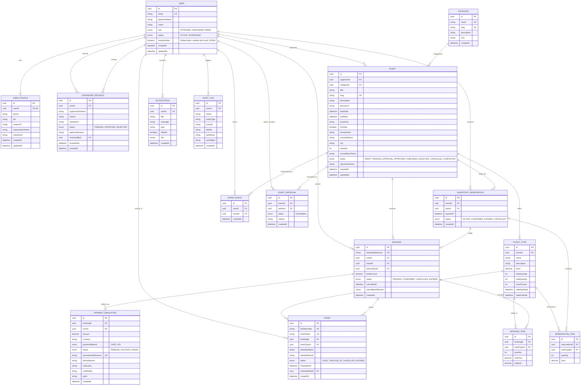

# EVENTRA Entity-Relationship (ER) Model & Database Schema

This document details the relational data model for the **EVENTRA** Event Discovery, Booking & Ticketing Platform. The database is designed in Third Normal Form (3NF) on **PostgreSQL** (hosted on Neon Serverless) and managed via **Prisma ORM 5**.

---

## 1. Entity-Relationship Diagram

---

## 2. Enums Reference

The platform enforces strict type constraints across state machines using PostgreSQL native enumerations:

| Enum Name | Allowed Values | Description |
| :--- | :--- | :--- |
| `UserRole` | `ATTENDEE`, `ORGANIZER`, `ADMIN` | Role-Based Access Control tier for platform permissions. |
| `AccountStatus` | `ACTIVE`, `SUSPENDED` | Account moderation status governing authentication access. |
| `OrganizerRequestStatus`| `PENDING`, `APPROVED`, `REJECTED` | Review lifecycle of attendee applications to become organizers. |
| `EventStatus` | `DRAFT`, `PENDING_APPROVAL`, `APPROVED`, `PUBLISHED`, `REJECTED`, `CANCELLED`, `COMPLETED` | State machine governing event publication and visibility. |
| `ReservationStatus` | `ACTIVE`, `CONFIRMED`, `EXPIRED`, `CANCELLED` | Lifecycle of temporary 10-minute inventory holds. |
| `BookingStatus` | `PENDING`, `CONFIRMED`, `CANCELLED`, `EXPIRED` | Confirmed transaction state for ticket orders. |
| `TicketStatus` | `VALID`, `CHECKED_IN`, `CANCELLED`, `EXPIRED` | Physical entry pass validation status. |
| `PaymentStatus` | `PENDING`, `SUCCESS`, `FAILED` | Simulated checkout gateway response. |
| `PaymentMethod` | `CARD`, `UPI` | Supported checkout payment instruments. |

---

## 3. Relational Model Reference Tables

### 3.1 User & Identity Models

#### `User`
Stores core authentication credentials and global account metadata.
- `id` (String, UUID, Primary Key)
- `email` (String, Unique)
- `passwordHash` (String) — Hashed with bcryptjs (salt rounds: 12)
- `name` (String)
- `role` (`UserRole`, Default: `ATTENDEE`)
- `status` (`AccountStatus`, Default: `ACTIVE`)
- `emailVerified` (Boolean, Default: `false`) — Persisted account verification status (verified via mock code `123456`)
- `createdAt` (DateTime, Default: `now()`)
- `updatedAt` (DateTime, Auto-updated)
- **Indexes**: `[role]`, `[status]`

#### `UserProfile`
Extended profile information for personal and organizer branding.
- `id` (String, UUID, Primary Key)
- `userId` (String, UUID, Foreign Key -> `User.id`, Unique, `onDelete: Cascade`)
- `phone` (String, Optional)
- `bio` (String, Optional)
- `avatarUrl` (String, Optional)
- `organizationName` (String, Optional)
- `websiteUrl` (String, Optional)
- `createdAt` (DateTime, Default: `now()`)
- `updatedAt` (DateTime, Auto-updated)

#### `OrganizerRequest`
Tracks attendee requests for promotion to the Organizer role.
- `id` (String, UUID, Primary Key)
- `userId` (String, UUID, Foreign Key -> `User.id`, `onDelete: Cascade`)
- `organizationName` (String)
- `reason` (String)
- `websiteUrl` (String, Optional)
- `status` (`OrganizerRequestStatus`, Default: `PENDING`)
- `rejectionReason` (String, Optional)
- `reviewedById` (String, UUID, Foreign Key -> `User.id`, Optional)
- `reviewedAt` (DateTime, Optional)
- `createdAt` (DateTime, Default: `now()`)
- **Indexes**: `[userId]`, `[status]`

---

### 3.2 Event Taxonomy & Logistics Models

#### `Category`
Event grouping taxonomy.
- `id` (String, UUID, Primary Key)
- `name` (String, Unique)
- `slug` (String, Unique)
- `description` (String, Optional)
- `icon` (String, Optional)
- `createdAt` (DateTime, Default: `now()`)

#### `Event`
Core entity representing physical, hybrid, or online gatherings.
- `id` (String, UUID, Primary Key)
- `organizerId` (String, UUID, Foreign Key -> `User.id`, `onDelete: Cascade`)
- `categoryId` (String, UUID, Foreign Key -> `Category.id`, `onDelete: Restrict`)
- `title` (String)
- `slug` (String, Unique)
- `description` (String, Text)
- `bannerUrl` (String, Optional)
- `startDate` (DateTime)
- `endDate` (DateTime)
- `timeZone` (String, Default: `'UTC'`)
- `isOnline` (Boolean, Default: `false`)
- `venueName` (String, Optional)
- `venueAddress` (String, Optional)
- `city` (String, Optional)
- `capacity` (Int) — Maximum attendance limit
- `cancellationPolicy` (String, Optional)
- `status` (`EventStatus`, Default: `DRAFT`)
- `rejectionReason` (String, Optional)
- `createdAt` (DateTime, Default: `now()`)
- `updatedAt` (DateTime, Auto-updated)
- **Indexes**: `[organizerId]`, `[categoryId]`, `[status]`, `[city]`, `[startDate]`

#### `TicketType`
Tiered inventory definitions for an event (e.g. VIP, General Admission, Early Bird).
- `id` (String, UUID, Primary Key)
- `eventId` (String, UUID, Foreign Key -> `Event.id`, `onDelete: Cascade`)
- `name` (String)
- `description` (String, Optional)
- `price` (Decimal, Precision 10, Scale 2)
- `totalQuantity` (Int)
- `soldQuantity` (Int, Default: `0`)
- `maxPerUser` (Int, Default: `10`)
- `saleStartDate` (DateTime, Optional)
- `saleEndDate` (DateTime, Optional)
- **Indexes**: `[eventId]`

---

### 3.3 Concurrency, Reservation & Booking Models

#### `InventoryReservation`
Temporary hold placed on ticket capacity during the 10-minute checkout window.
- `id` (String, UUID, Primary Key)
- `eventId` (String, UUID, Foreign Key -> `Event.id`, `onDelete: Cascade`)
- `userId` (String, UUID, Foreign Key -> `User.id`, `onDelete: Cascade`)
- `expiresAt` (DateTime) — Automatic 10-minute TTL expiry
- `status` (`ReservationStatus`, Default: `ACTIVE`)
- `createdAt` (DateTime, Default: `now()`)
- **Indexes**: `[userId]`, `[eventId]`, `[status]`, `[expiresAt]`

#### `ReservationItem`
Individual ticket types and quantities locked in an active hold.
- `id` (String, UUID, Primary Key)
- `reservationId` (String, UUID, Foreign Key -> `InventoryReservation.id`, `onDelete: Cascade`)
- `ticketTypeId` (String, UUID, Foreign Key -> `TicketType.id`, `onDelete: Cascade`)
- `quantity` (Int)
- `price` (Decimal, Precision 10, Scale 2)

#### `Booking`
Permanent transaction record confirmed upon successful payment simulation.
- `id` (String, UUID, Primary Key)
- `bookingReference` (String, Unique) — Format: `EVT-YYYYMMDD-XXXX`
- `userId` (String, UUID, Foreign Key -> `User.id`, `onDelete: Cascade`)
- `eventId` (String, UUID, Foreign Key -> `Event.id`, `onDelete: Restrict`)
- `reservationId` (String, UUID, Foreign Key -> `InventoryReservation.id`, Optional, Unique)
- `totalAmount` (Decimal, Precision 10, Scale 2)
- `status` (`BookingStatus`, Default: `PENDING`)
- `cancelledAt` (DateTime, Optional)
- `cancellationReason` (String, Optional)
- `createdAt` (DateTime, Default: `now()`)
- **Indexes**: `[userId]`, `[eventId]`, `[status]`, `[bookingReference]`

#### `BookingItem`
Line items of confirmed ticket purchases.
- `id` (String, UUID, Primary Key)
- `bookingId` (String, UUID, Foreign Key -> `Booking.id`, `onDelete: Cascade`)
- `ticketTypeId` (String, UUID, Foreign Key -> `TicketType.id`, `onDelete: Restrict`)
- `quantity` (Int)
- `unitPrice` (Decimal, Precision 10, Scale 2)
- `subtotal` (Decimal, Precision 10, Scale 2)

---

### 3.4 Tickets, Gate Passes & Settlement Models

#### `Ticket`
Scannable digital entry pass with cryptographic validation token.
- `id` (String, UUID, Primary Key)
- `ticketNumber` (String, Unique) — Format: `TKT-XXXXXXXXXXXX`
- `ticketToken` (String, Unique) — Cryptographically opaque UUID embedded into QR code
- `bookingId` (String, UUID, Foreign Key -> `Booking.id`, `onDelete: Cascade`)
- `ticketTypeId` (String, UUID, Foreign Key -> `TicketType.id`, `onDelete: Restrict`)
- `attendeeName` (String)
- `attendeeEmail` (String)
- `status` (`TicketStatus`, Default: `VALID`)
- `checkedInAt` (DateTime, Optional)
- `checkedInById` (String, UUID, Foreign Key -> `User.id`, Optional)
- `createdAt` (DateTime, Default: `now()`)
- **Indexes**: `[ticketToken]`, `[ticketNumber]`, `[bookingId]`, `[status]`

#### `PaymentSimulation`
Settlement log for Card and UPI payment executions.
- `id` (String, UUID, Primary Key)
- `bookingId` (String, UUID, Foreign Key -> `Booking.id`, `onDelete: Cascade`)
- `userId` (String, UUID, Foreign Key -> `User.id`, `onDelete: Cascade`)
- `amount` (Decimal, Precision 10, Scale 2)
- `currency` (String, Default: `'INR'`)
- `paymentMethod` (`PaymentMethod`)
- `status` (`PaymentStatus`, Default: `PENDING`)
- `transactionReference` (String, Unique) — Format: `TXN-XXXXXXXXXXXX`
- `failureReason` (String, Optional)
- `cardLast4` (String, Optional)
- `cardHolder` (String, Optional)
- `upiId` (String, Optional)
- `createdAt` (DateTime, Default: `now()`)
- **Indexes**: `[bookingId]`, `[transactionReference]`, `[status]`

---

### 3.5 Engagement, Moderation & Audit Models

#### `SavedEvent`
User bookmarks / wishlist.
- `id` (String, UUID, Primary Key)
- `userId` (String, UUID, Foreign Key -> `User.id`, `onDelete: Cascade`)
- `eventId` (String, UUID, Foreign Key -> `Event.id`, `onDelete: Cascade`)
- `createdAt` (DateTime, Default: `now()`)
- **Unique Constraint**: `[userId, eventId]`

#### `Notification`
In-app notification drawer alerts.
- `id` (String, UUID, Primary Key)
- `userId` (String, UUID, Foreign Key -> `User.id`, `onDelete: Cascade`)
- `title` (String)
- `message` (String)
- `type` (String, Default: `'INFO'`)
- `isRead` (Boolean, Default: `false`)
- `link` (String, Optional)
- `createdAt` (DateTime, Default: `now()`)
- **Indexes**: `[userId]`, `[isRead]`

#### `EventApproval`
Administrative audit trail for event moderation decisions.
- `id` (String, UUID, Primary Key)
- `eventId` (String, UUID, Foreign Key -> `Event.id`, `onDelete: Cascade`)
- `adminId` (String, UUID, Foreign Key -> `User.id`, `onDelete: Cascade`)
- `status` (`EventStatus`)
- `reason` (String, Optional)
- `createdAt` (DateTime, Default: `now()`)
- **Indexes**: `[eventId]`

#### `AuditLog`
Platform-wide activity log for security, administrative, and financial events.
- `id` (String, UUID, Primary Key)
- `userId` (String, UUID, Foreign Key -> `User.id`, Optional)
- `action` (String)
- `entityType` (String)
- `entityId` (String, Optional)
- `details` (String, Text, Optional)
- `ipAddress` (String, Optional)
- `userAgent` (String, Optional)
- `createdAt` (DateTime, Default: `now()`)
- **Indexes**: `[userId]`, `[action]`, `[entityType]`
