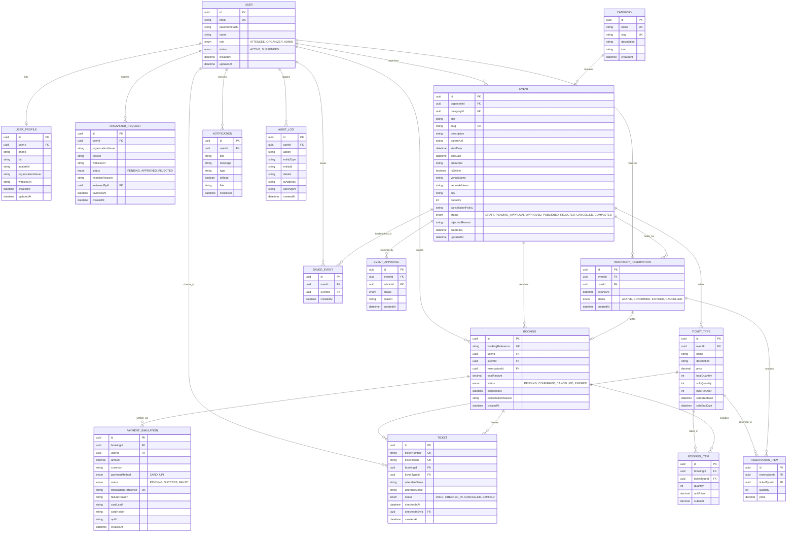

# EVENTRA Entity-Relationship (ER) Model

The EVENTRA database is designed in Third Normal Form (3NF) on PostgreSQL with strict referential integrity, foreign key cascading where appropriate, and composite indexes on query paths.

