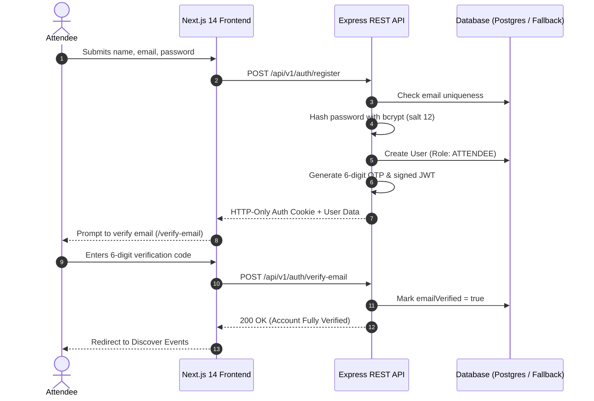
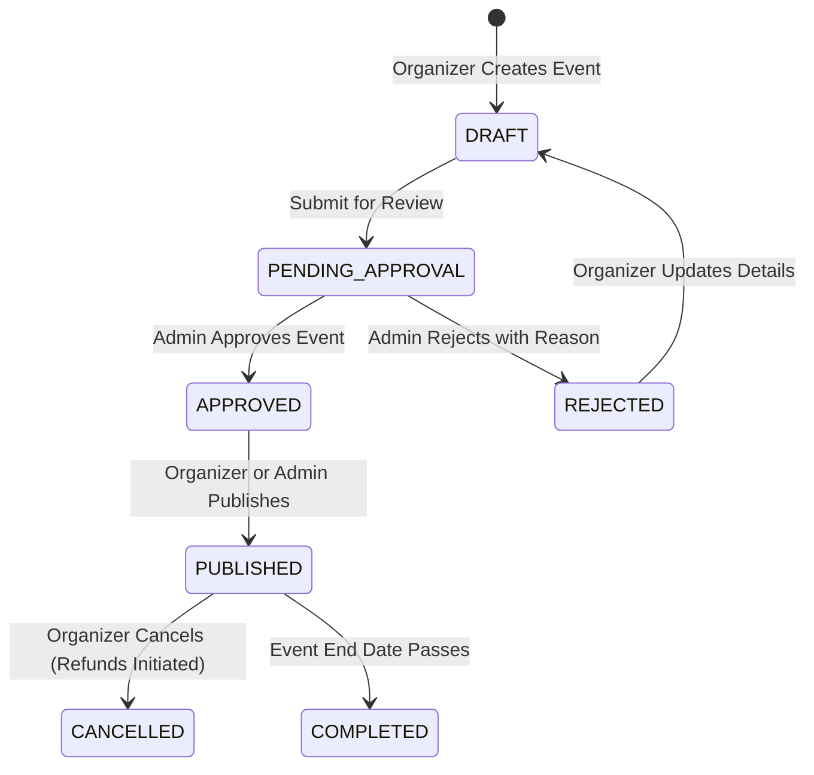
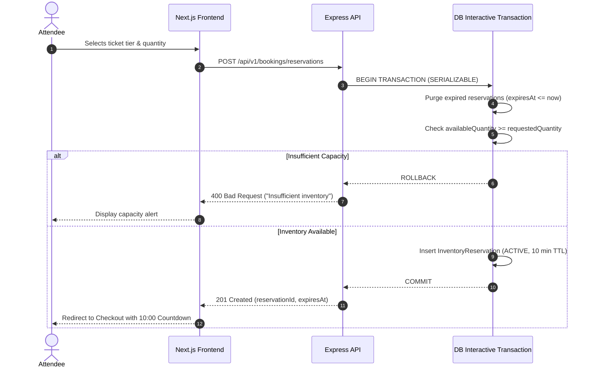
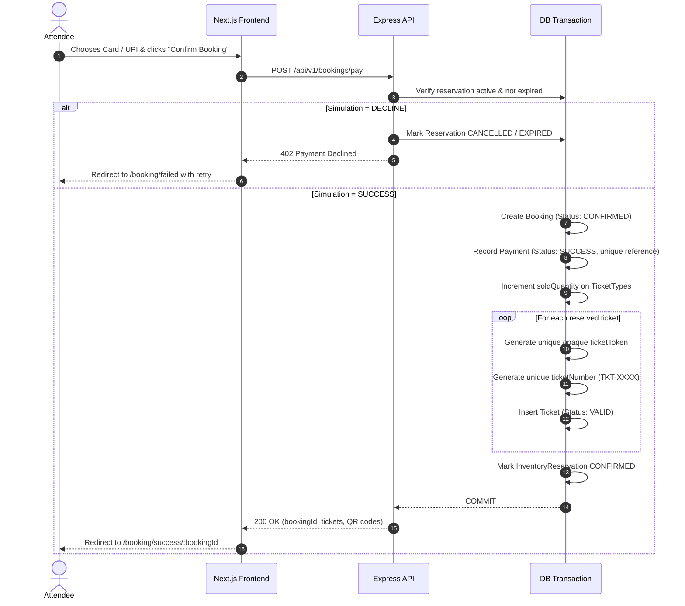
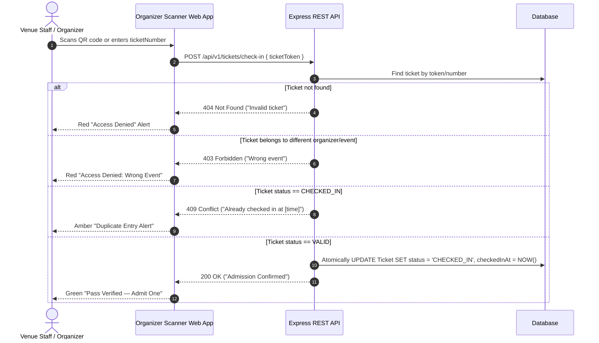
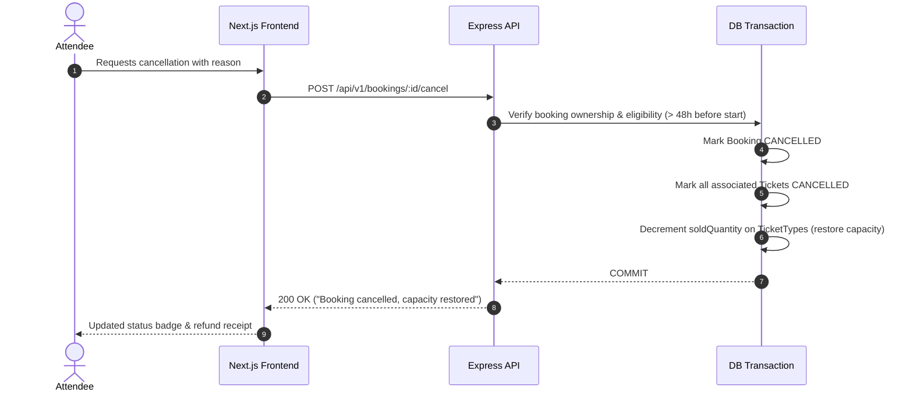

# EVENTRA — System Flow Diagrams

This document illustrates the end-to-end lifecycle flows for the EVENTRA ticketing platform:
1. Registration & Email Verification
2. Event Creation, Draft Submission & Admin Approval
3. Ticket Selection & 10-Minute Concurrency-Safe Hold
4. Mock Payment Simulation & Idempotent Confirmation
5. Scannable QR Pass Generation & Verification
6. Gate Admission Check-In & Double-Entry Rejection
7. Booking Cancellation & Inventory Release

---

## 1. Registration & Email Verification Flow

---

## 2. Event Creation & Admin Approval Lifecycle

---

## 3. Concurrency-Safe Ticket Reservation (10-Minute Hold)

---

## 4. Mock Payment & Idempotent Ticket Generation

---

## 5. Gate Admission & Check-In Validation Flow

---

## 6. Booking Cancellation & Inventory Release

