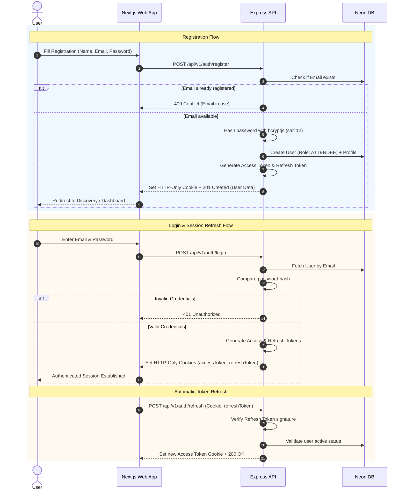
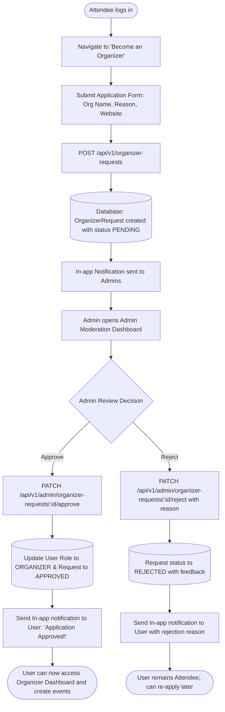
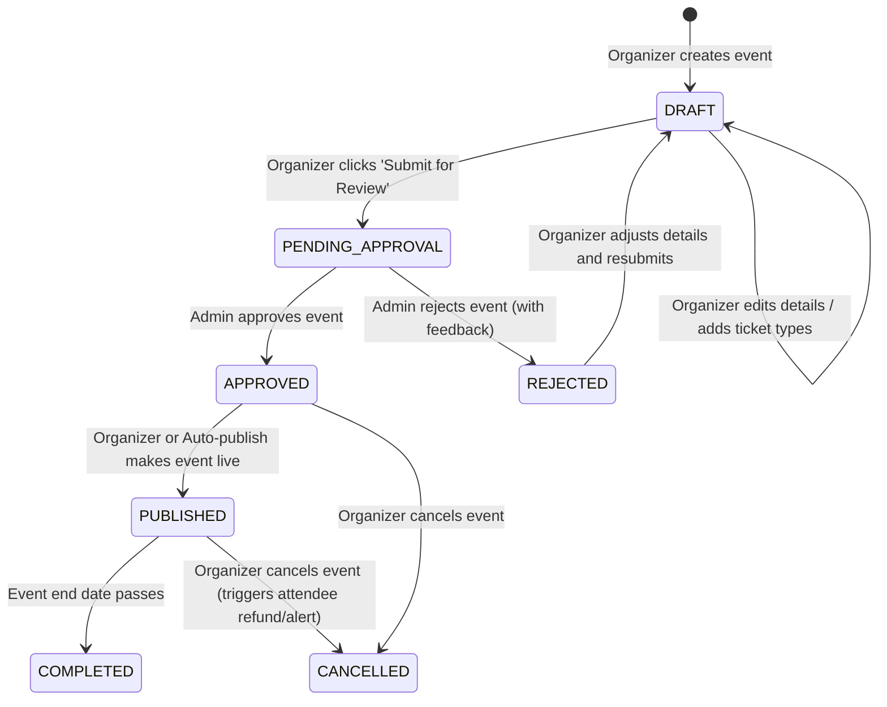
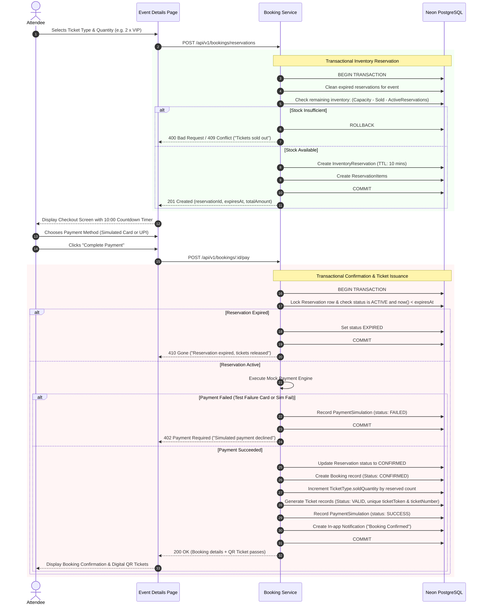
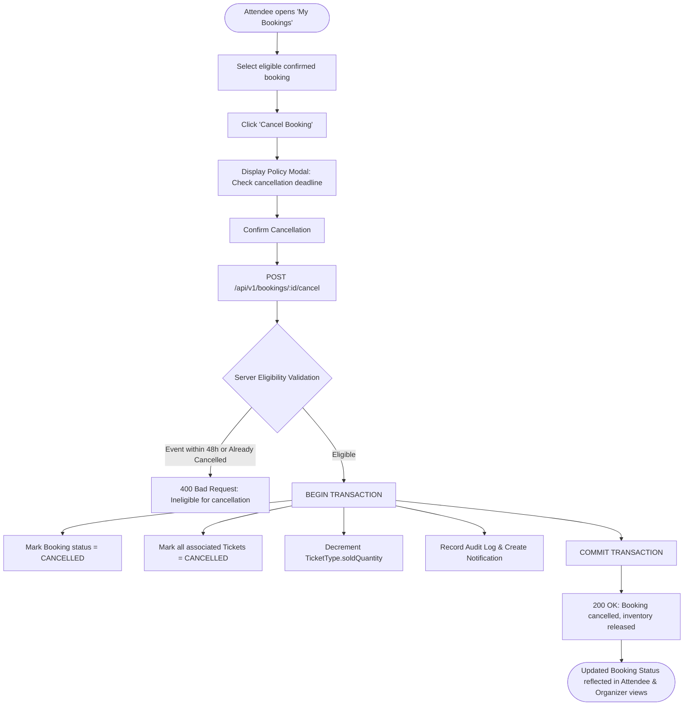
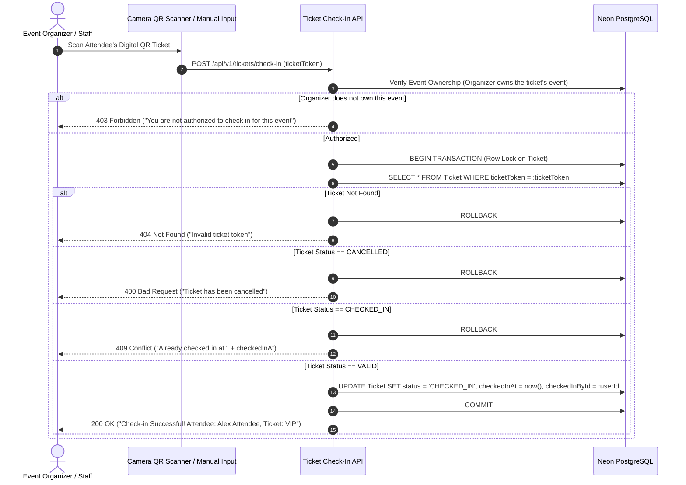

# EVENTRA System Workflows & Flowcharts

This document specifies the operational flows for authentication, organizer onboarding, event management, ticketing, concurrency-safe booking, and check-in validation.

---

## 1. Authentication & Session Flow

---

## 2. Organizer Onboarding & Approval Flow

---

## 3. Event Creation, Moderation, and Publication Flow

---

## 4. Concurrency-Safe Ticket Booking & Mock Payment Flow

---

## 5. Booking Cancellation Flow

---

## 6. QR Code Check-In Validation Flow

