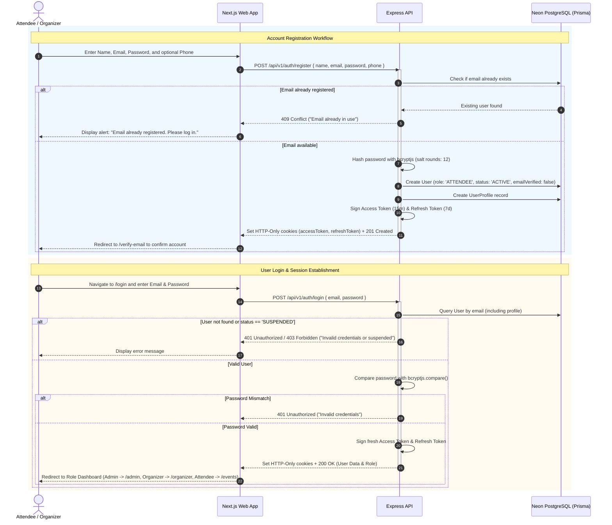
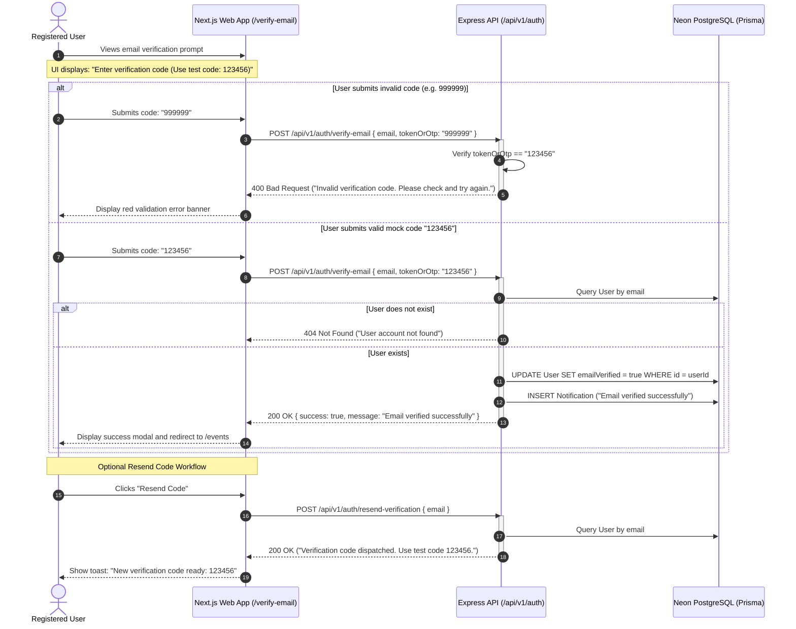
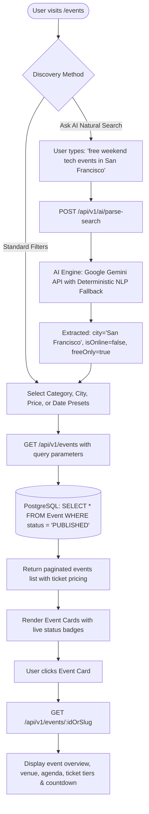
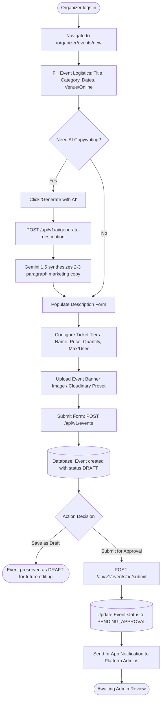
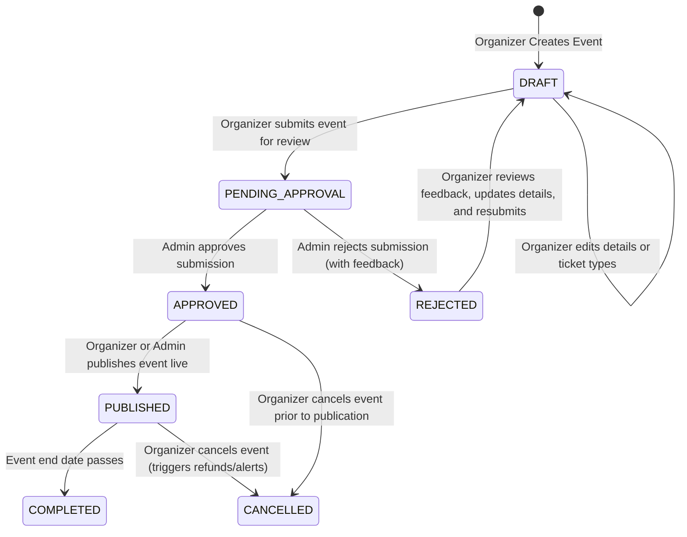
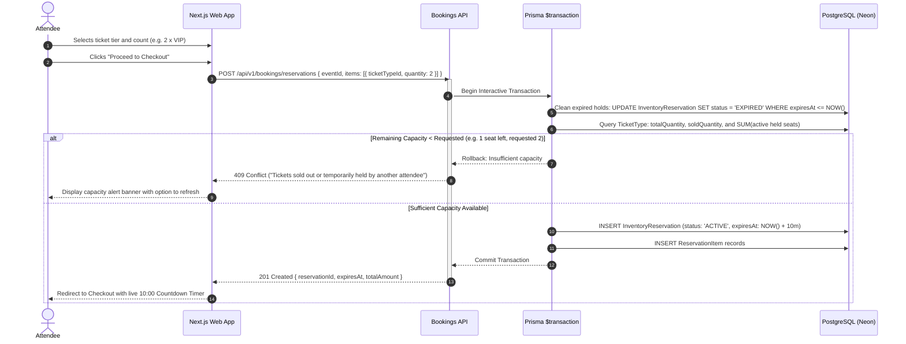
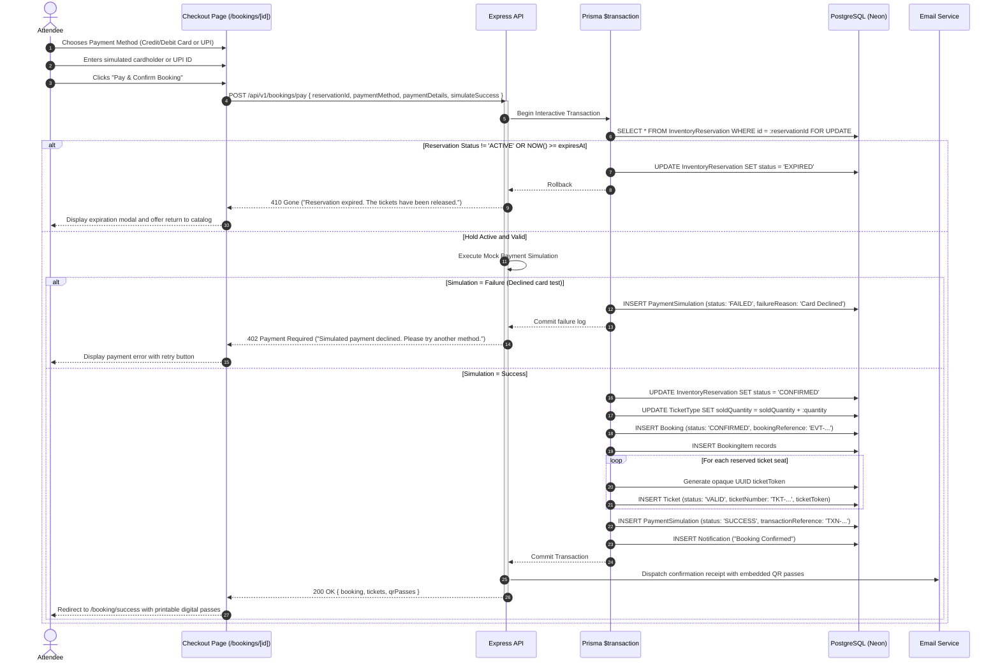
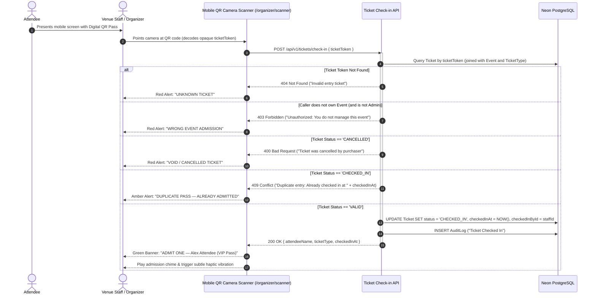
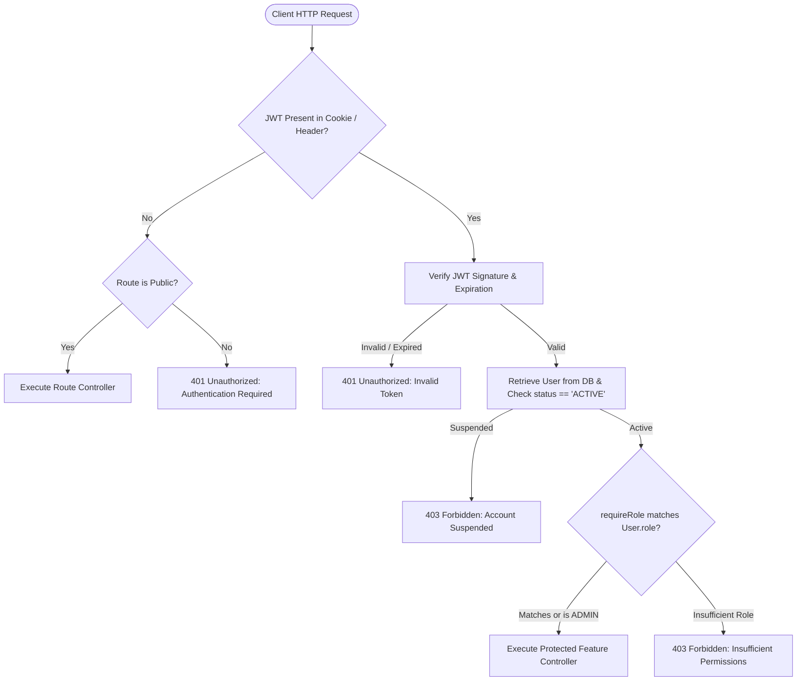

# EVENTRA System Workflows & Flowcharts

This document specifies the end-to-end operational workflows for the **EVENTRA** Event Discovery, Booking & Ticketing Platform. Each flow is modeled with Mermaid flowcharts, sequence diagrams, and state machines to provide an exhaustive technical reference for development, QA, and security auditing.

---

## 1. User Registration & Login Flow

The platform provides role-aware authentication using JSON Web Tokens (JWT) stored in HTTP-Only cookies.



---

## 2. Mock Email Verification Flow

To provide an instant, reliable verification experience during testing and demonstration without external SMTP failure risks, the platform implements a deterministic mock email verification flow using the fixed code `123456`.



---

## 3. Event Discovery, AI Search & Filtering Flow



---

## 4. Organizer Event Creation & Publishing Flow

Organizers configure tiered tickets, seating capacity, and event descriptions with integrated Google Gemini AI assistance.



---

## 5. Admin Moderation & Approval Workflow



---

## 6. Concurrency-Safe Ticket Reservation (10-Minute Hold)

The two-phase reservation protocol locks seat inventory inside an interactive transaction to prevent overselling during high-concurrency booking rushes.



---

## 7. Mock Payment Simulation & Booking Confirmation Flow



---

## 8. QR Ticket Generation & Gate Scanner Check-in Flow



---

## 9. Self-Service Booking Cancellation Flow

```mermaid
flowchart TD
    A([Attendee visits /tickets or /bookings/:id]) --> B[Select Confirmed Booking]
    B --> C[Click 'Cancel Booking']
    C --> D[Display Cancellation Policy & Confirmation Modal]
    D --> E[Attendee enters cancellation reason & confirms]
    E --> F[POST /api/v1/bookings/:id/cancel]
    
    F --> G{Server Eligibility Validation}
    G -->|Event starts in less than 48 hours| H[400 Bad Request: Ineligible under 48h cancellation policy]
    G -->|Already Cancelled| I[400 Bad Request: Booking already cancelled]
    
    G -->|Eligible for Cancellation| J[Begin Database Interactive Transaction]
    J --> K[UPDATE Booking SET status = 'CANCELLED', cancelledAt = NOW()]
    J --> L[UPDATE Ticket SET status = 'CANCELLED' WHERE bookingId = :id]
    J --> M[UPDATE TicketType SET soldQuantity = soldQuantity - quantity]
    J --> N[INSERT Notification to Attendee & Organizer]
    J --> O[Commit Transaction]
    
    O --> P[Dispatch Cancellation Email Alert]
    P --> Q[200 OK: Booking cancelled, capacity returned to pool]
    Q --> R([UI updates status badge to CANCELLED and hides QR entry pass])
```

---

## 10. Role-Based Access Control (RBAC) & Route Protection Flow


